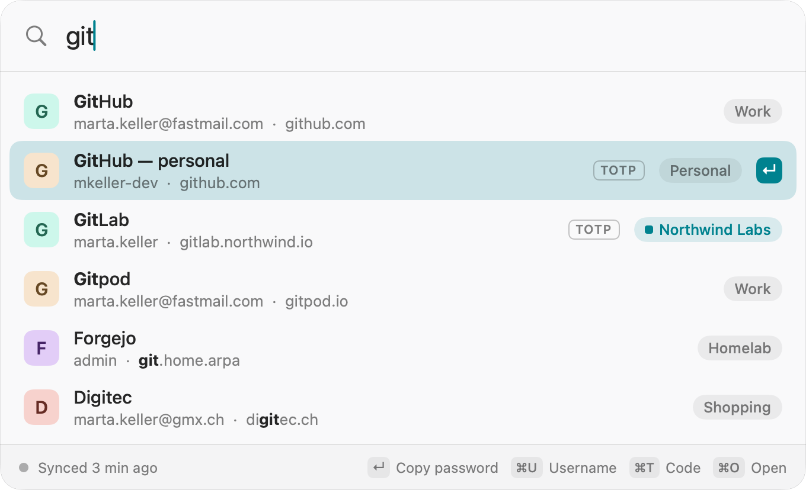
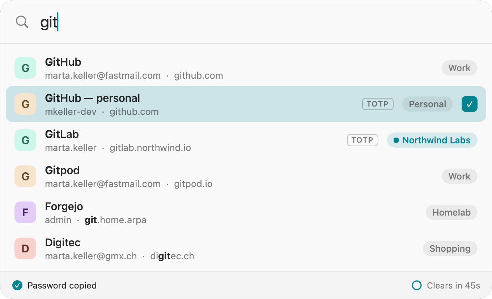
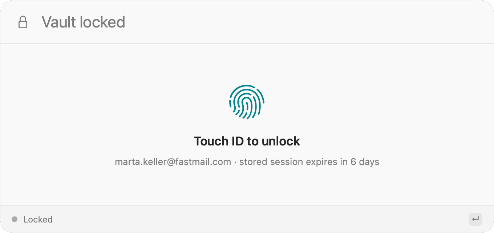
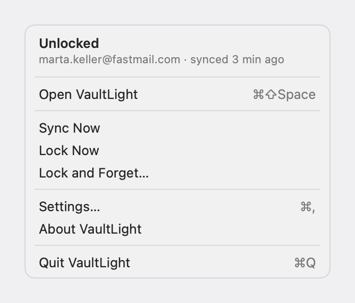
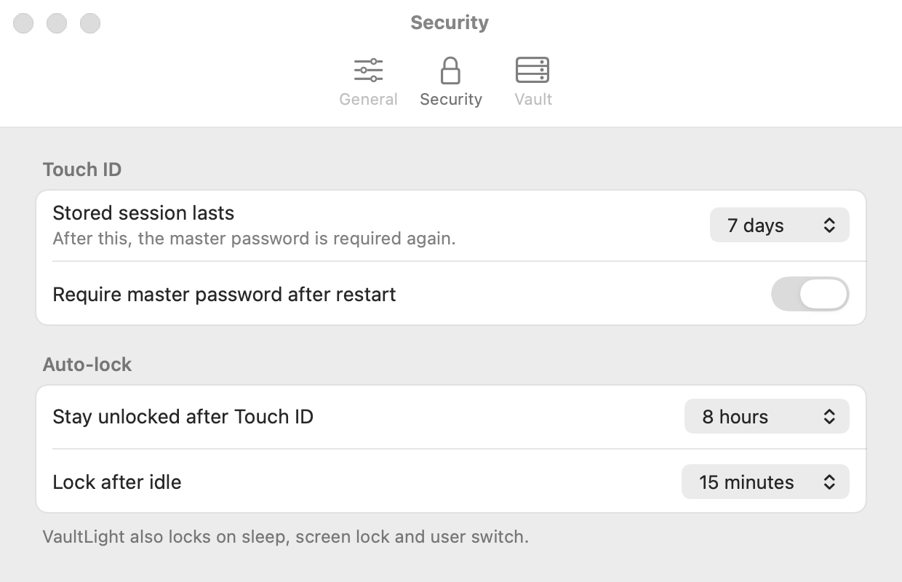
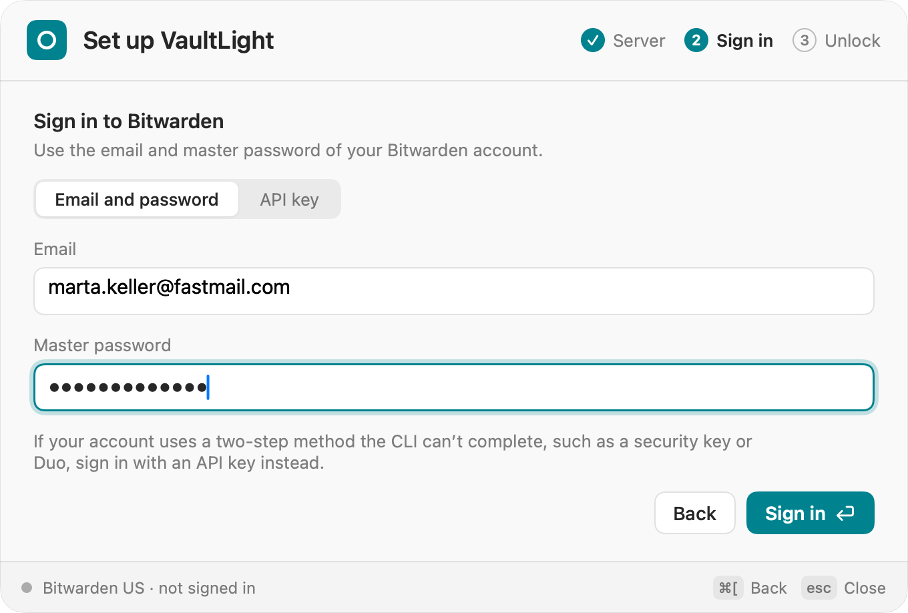

# VaultLight

A Spotlight-style quick-access panel for your Bitwarden vault on macOS. Press a hotkey from any app, type a few characters, press Return, and the password is on your clipboard.

VaultLight is an unofficial client and is not affiliated with Bitwarden.

- **Keyboard first.** Open the panel with Cmd + Shift + Space (changeable), search, then Return for the password, Cmd + U for the username, Cmd + T for the TOTP code, Cmd + O to open the site.
- **Works through the official `bw` CLI.** VaultLight starts `bw` for every vault operation and keeps its own CLI login, separate from any `bw` you use in Terminal.
- **Unlock with Touch ID.** The session key lives in the macOS Keychain behind user presence (Touch ID, Apple Watch or the Mac login password).
- **Private by default.** No favicon requests, and copied secrets are hidden from clipboard managers and cleared after a timeout.

<picture>
  <source media="(prefers-color-scheme: dark)" srcset="docs/screenshots/02-search-results-dark.png">
  
</picture>

## Using VaultLight

**Search and copy.** Type part of an item's name, username or website. Return copies the password and closes the panel, so you can paste straight into the app you were in. The footer counts down until the clipboard is cleared.

<picture>
  <source media="(prefers-color-scheme: dark)" srcset="docs/screenshots/04-password-copied-dark.png">
  
</picture>

| Keys | Action |
| --- | --- |
| Return or Cmd + P | Copy the password |
| Cmd + U | Copy the username (the panel stays open) |
| Cmd + T | Copy the TOTP code |
| Cmd + O | Open the website in your browser |
| Cmd + , | Open Settings |
| Escape | Close the panel |

**Unlock.** When the vault is locked, the panel asks for Touch ID, or for your master password after a restart or when the stored session has expired.

<picture>
  <source media="(prefers-color-scheme: dark)" srcset="docs/screenshots/06-locked-touchid-dark.png">
  
</picture>

**Menu bar.** The VaultLight menu opens the panel, syncs, locks the vault, and opens Settings.

<picture>
  <source media="(prefers-color-scheme: dark)" srcset="docs/screenshots/13-menubar-menu-unlocked-dark.png">
  
</picture>

**Settings.** Change the hotkey, session lifetimes, idle lock, clipboard timeout, sync interval, server and `bw` location.

<picture>
  <source media="(prefers-color-scheme: dark)" srcset="docs/screenshots/14-settings-security-dark.png">
  
</picture>

The screenshots show an invented demo vault.

## Requirements

- macOS 14 (Sonoma) or later
- [Homebrew](https://brew.sh) and the Bitwarden CLI (`bitwarden-cli`), which the cask installs for you

## Install

```bash
brew tap dzsubek/tap
brew trust --tap dzsubek/tap
brew install --cask dzsubek/tap/vaultlight
```

Since Homebrew 6.0, Homebrew runs code from a third-party tap only after you trust it, which is what `brew trust --tap dzsubek/tap` does. Read the cask in the tap first if you want to know what it will run.

On first launch, VaultLight asks for your server (Bitwarden US, EU or self-hosted), signs you in with your email and master password or a personal API key, and unlocks the vault. The master password is never stored.

<picture>
  <source media="(prefers-color-scheme: dark)" srcset="docs/screenshots/11-onboarding-signin-email-dark.png">
  
</picture>

## Update

```bash
brew update
brew upgrade --cask vaultlight
```

There is no in-app updater.

## Uninstall

Remove the session key from the Keychain **first**: choose **Lock and Forget** from the VaultLight menu-bar menu, or **Sign Out…** in Settings. `brew uninstall --zap` cannot reach the data-protection Keychain, so a session key you leave behind stays there until you delete it by hand.

Then:

```bash
brew uninstall --zap --cask vaultlight
```

`--zap` also removes `~/Library/Application Support/VaultLight` (the CLI's own data folder), the preferences file and the login item.

## Security

- The search index holds names, usernames, hosts and folders only. A password or TOTP code is fetched when you copy it.
- Copied secrets are written for this Mac only, marked concealed and transient for clipboard managers, and cleared after the timeout (45 s by default) unless you copied something else meanwhile.
- The stored session key has a maximum age, can require the master password after a restart, and is cleared from memory on sleep, screen lock, user switch and idle.

## License

VaultLight is [Fair Source](https://fair.io) under the [Functional Source License 1.1, MIT Future License](LICENSE.md) (`FSL-1.1-MIT`).

- You may use, copy, modify and redistribute VaultLight for any purpose except a **Competing Use**: making it, or a fork, available to others in a commercial product or service that substitutes for VaultLight or offers the same or substantially similar functionality.
- Using it yourself, including at work, is permitted, and so are non-commercial forks.
- Each release also becomes available under the MIT license two years after it is published.

Until a release converts to MIT, VaultLight is source-available, not "open source" in the OSI sense. Its full source is public so anyone can audit it.

VaultLight runs the `bw` CLI you install yourself as a separate program. It does not bundle, link or copy Bitwarden's code. Bitwarden is a trademark of Bitwarden, Inc.
